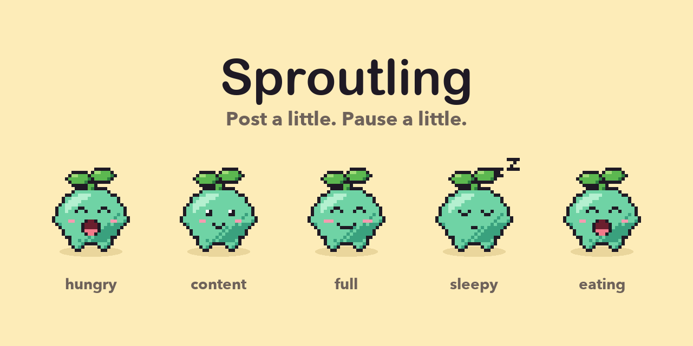

<p align="center">
  
</p>

# Sproutling

A pixel pet that lives in your browser, helps you remember your Buffer posting streak, and keeps you company when the scrolling goes on a while, with a kind word to stretch, sip some water and look up. Send a post and it perks up. Let the queue run dry and it gets hungry. Ignore it for a few days and it takes a nap (it never dies, we're not monsters).

It sits in the corner of the Buffer web app, and, once you let it, on the sites of the channels you've connected.

Built for **Buffer Commit**. Work in progress.

## How it works

The pet is a mood computed from your Buffer account, read-only:

- **Fullness**: posts sent this period against your posting goals. With no goals set, posts sent in the last 7 days against a target of 3.
- **Fridge**: scheduled posts. Food is on the way, so the pet stays calm.
- **Snacks**: drafts created today, with a small capped bonus. **Treats**: new ideas, purely cosmetic.
- **Feeding**: when a poll finds newer activity than the last one, the pet eats for a few seconds.

Connecting Buffer is optional. Without it, Sproutling can still keep you company on the sites you allow, with the scroll nudges, and the posting side just waits.

A service worker polls every 15 minutes (plus a throttled nudge when the Buffer tab becomes visible), writes the result to storage, and the overlay in each tab just reads it.

## Setup

You'll need Node 20+ and pnpm. The repo pins its pnpm version, so `corepack enable` is enough.

```sh
pnpm install
pnpm dev          # builds, opens a browser with the extension loaded
pnpm build        # production build in .output/chrome-mv3
pnpm test         # Vitest
pnpm typecheck
```

To load a build by hand: `chrome://extensions`, enable Developer mode, **Load unpacked**, pick `.output/chrome-mv3`.

### Buffer app client

Connecting needs a public app client in Buffer (Settings, API, App Clients):

- Public client with PKCE, scopes `account:read posts:read ideas:read`, plus `offline_access` so the session can refresh.
- Redirect URI: `https://sproutling.pet/callback.html` (the page in `site/`).
- The client ID lives in `src/lib/config.ts`. It's public by design.
- The token endpoint only accepts requests whose `Origin` matches a redirect URI's origin, and an extension's `chrome-extension://` origin can't be registered. So the callback page does the code exchange and hands the tokens to the extension (`externally_connectable`). The manifest pins the public key, so the extension ID the page talks to is the same on every machine.

The private signing key is not in the repo. You only need it to publish to the Chrome Web Store.

### Sprites and brand images

Sprites are generated, not hand-edited, so shading and outlines stay consistent.

```sh
cd tools/sprites
python3 -m venv .venv && .venv/bin/pip install -r requirements.txt
.venv/bin/python draw.py     # sheets + timing JSON into src/public/sprites, review GIFs into preview/
.venv/bin/python brand.py    # extension icons, 512px logo, README banner
```

`draw.py` also copies the sheets into `site/sprites/`, so the landing page stays self-contained. To preview it, run `pnpm site:dev`.

### Sounds

The voice effects are cut from raw takes recorded by hand (kept out of the repo and out of the extension).

```sh
node tools/sounds/cut.mjs            # raw takes in tools/sounds/raw -> mp3 clips in src/lib/overlay/sounds
node tools/sounds/cut.mjs --dry-run  # just print the plan
```

It needs ffmpeg. It finds each sound by silence, keeps a short "tk" attached to the step that follows it, drops quiet noise, fades the edges and normalises every clip. The walking take becomes one seamless loop at its own tempo, which plays for as long as Sproutling walks. `TAKES` at the top says how each take is named. The clips are bundled into the content scripts and played with WebAudio.

`tools/sprites/preview.html` plays a sheet in the browser. Serve the repo root (`npx serve .`) and open `/tools/sprites/preview.html`.

## Layout

```
src/
  entrypoints/   service worker, content scripts, popup
  lib/
    auth/        PKCE, token storage and refresh, connect flow
    api/         GraphQL client, the poll query, response mapping
    pet/         computePetState and friends (pure, tested)
    overlay/     shadow-root host, canvas sprite player, shared pet mount
    platforms/   channel → site map, runtime content-script registration
  public/        sprites and icons, copied into the build
site/            static landing page (plain HTML/CSS/JS, deploys as-is)
tools/sprites/   Python sprite and brand generators
tools/sounds/    ffmpeg script that cuts voice takes into clips
tools/video/     title and end cards for the demo video
docs/brand/      banner and logo
```

## Guiding principles

- **One poller, one refresher.** Only the service worker talks to the API. Tabs read stored state. Refresh tokens rotate, so refresh is single-flight and the new token is saved before it's used.
- **Tokens live in the service worker.** Content scripts never get them, and never drive auth. The callback page only sees them for the moment between Buffer and the extension, and the extension checks the `state` it issued before accepting anything.
- **Read-only, and gentle with the rate limit.** Minimal scopes. One aliased GraphQL request per poll, because the API allows roughly 100 requests per 15 minutes.
- **Never block the host page.** The overlay wrapper ignores pointer events; only the pet itself catches them. It lives in a closed shadow root and puts itself back if a single-page app rips it out.
- **Ask for permissions at the moment they make sense.** Social sites are optional host permissions, requested only when you tap a connected channel in the popup. The pet's sprites are bundled into the content script, so sites can't detect the extension by probing for its files.
- **Pixel art stays crisp.** Whole-pixel frames, integer scaling, no rotation or sub-pixel transforms. Feet never move.
- **Calm by default.** The pet idles gently, pauses when the tab is hidden, and holds a still frame under `prefers-reduced-motion`. It has an accessible name that says how it's doing.
- **Logic is pure, then tested.** Mood rules, response mapping and token math are plain functions with unit tests. The browser glue stays thin.
- **Small and boring.** Vanilla TypeScript in content scripts, no framework, no backend. Comments explain why, briefly.
